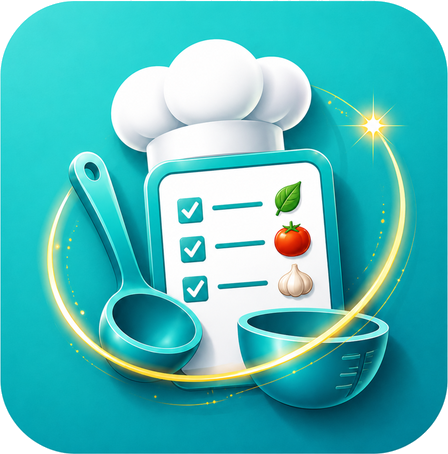
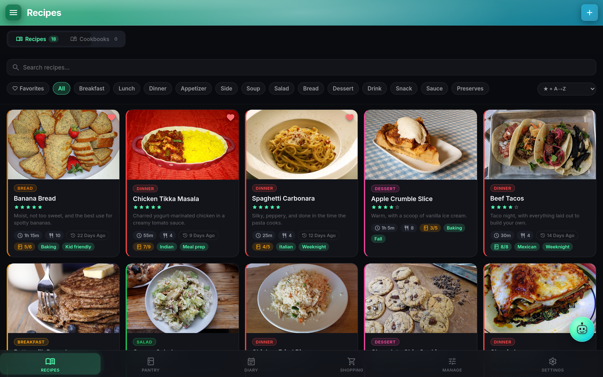

<h1 align="center">CookTrace</h1>

<p align="center"><b>Trace Every Recipe, From Pantry to Plate</b></p>

<p align="center">A self-hosted recipe, pantry, and cooking tracker.<br/>
No accounts, no telemetry, no cloud sync unless you opt in.</p>

<p align="center">
  
</p>

<p align="center">
  <a href="LICENSE"></a>
  <a href="https://github.com/traceapps/cooktrace/releases/latest"></a>
  <a href="https://github.com/traceapps/cooktrace/releases"></a>
  <a href="https://github.com/traceapps/cooktrace/stargazers"></a>
  <a href="https://traceapps.github.io/docs/getting-started/compose/"></a>
  <br/>
  <a href="https://traceapps.github.io/docs/cooktrace/"></a>
  <a href="https://github.com/traceapps/cooktrace/pkgs/container/cooktrace"></a>
  <a href="https://hub.docker.com/r/traceapps/cooktrace"></a>
  <a href="https://hosted.weblate.org/engage/cooktrace/"></a>
</p>

<p align="center">
  <b>Coming to Apple devices:</b> the Trace apps have no iPhone app yet, because building and testing one needs a Mac and an iPhone.
  <a href="https://ko-fi.com/traceapps">Chip in on Ko-fi</a>. Self-hosting stays free either way.
</p>

---

**Jump to:** [What it is](#what-cooktrace-is) · [Features](#features) · [Install](#install) · [Env vars](#env-vars) · [Docs](https://traceapps.github.io/docs/cooktrace/)

---

## What CookTrace is

CookTrace runs as a single Docker container on your own hardware, with a PWA for the browser and a native Android app for your phone. No accounts on external services, no data leaving your network, no subscriptions.

Third app in the Trace family alongside [NutriTrace](https://github.com/traceapps/nutritrace), [LiftTrace](https://github.com/traceapps/lifttrace), and [NoteTrace](https://github.com/traceapps/notetrace).

## Principles

- **Self-hosting is and will remain free.** The server, PWA, and source code will never be paywalled.
- **No trackers, no analytics, no telemetry.** CookTrace doesn't phone home; your usage is invisible to anyone but you.
- **Your data stays on your hardware.** No central server, no cloud sync that can read it; nothing leaves your network unless you opt into a third-party integration (Open Food Facts, USDA, an AI provider).
- **Open source under AGPL-3.0.** Every line that touches your data is readable.

---



---

## Features

### Cooking
- **Recipe library.** Full recipe model, every version kept in History (compare, name, restore), cook mode with timers that ring on a locked phone, cook log, live scaling with fraction-aware ingredient math, per-step photos, inline unit converter, FDA-style 34-nutriment Nutrition Facts box. → [full guide](https://traceapps.github.io/docs/cooktrace/recipes/)
- **Pantry.** Variants, expiration digests, barcode scanning (ML Kit native, QuaggaJS web), OFF + USDA quality signals, pantry-match pill on every recipe card. → [full guide](https://traceapps.github.io/docs/cooktrace/pantry/)
- **Cook Diary + Meal Planner.** List, Week, Month and Photos views, plan-then-cook flow with servings, drag to re-plan. Build My Week picks a week of dinners from what's in your pantry, and Uses Up shows what's about to expire and the recipes that would use it. → [full guide](https://traceapps.github.io/docs/cooktrace/diary/)
- **Shopping list.** Generate from a recipe (skips stocked items) or a whole week's plan, scaled to the servings planned and added up across recipes, aisle grouping.
- **App icon shortcuts.** Long-press the app icon (Android, or the installed web app) for Shopping List, or Scan to Pantry to open the Pantry with its barcode scanner. → [full guide](https://traceapps.github.io/docs/cooktrace/shopping/#app-icon-shortcuts)
- **Household and allergens.** Who you cook for, with allergies, diets and the days they're home; allergen warnings on every recipe, Safe for Everyone filtering. → [full guide](https://traceapps.github.io/docs/cooktrace/shopping/)

### Organizing
- **Cookbooks + Kitchens.** Named collections, per-user and public-link shares, Kitchens for household-wide fanout with Auto-Share. → [Cookbooks](https://traceapps.github.io/docs/cooktrace/cookbooks/) · [Kitchens](https://traceapps.github.io/docs/cooktrace/kitchens/)
- **Recipe import.** URL (Standard / Enhanced / Smart tiers), file, photo, and bulk Mealie / Mealime / Paprika / Tandoor archives. → [full guide](https://traceapps.github.io/docs/cooktrace/import/)
- **Manage catalog.** Categories (with color dots), tags, kitchen gear, pantry categories, units, cookbooks; drag-to-reorder with per-row recipe counts.

### AI + Federation
- **Trace AI.** Reads your recipes, pantry, diary, and cookbooks; can log a cook, plan a meal, add to shopping, or import a recipe from a URL, all conversationally. 21 tools total. Multi-provider (Claude / OpenAI / Gemini / any OpenAI-compatible endpoint). Smart Log voice, image attach, cook-mode voice control. → [full guide](https://traceapps.github.io/docs/cooktrace/trace/)
- **NutriTrace federation.** Pull food data from NutriTrace into your pantry, per user, with a Bearer token. → [full guide](https://traceapps.github.io/docs/cooktrace/nt-federation/)
- **Model Context Protocol (MCP).** Expose your recipes, pantry, shopping list, and cook diary to external AI agents (Claude Desktop, Cursor, Codex) via the standard MCP Streamable HTTP transport. Off by default; opt in with `MCP_ENABLED=1`. Read, write, and destructive tool tiers, each independently gated by its own env flag and token scope. → [full guide](https://traceapps.github.io/docs/cooktrace/mcp/)

### Accounts + platforms
- **Multi-user + OIDC SSO.** Authentik, Keycloak, Pocket ID, Authelia, Auth0, Google. Auto-link verified emails, optional auto-register, admin-group claims, RP-initiated logout. → [full guide](https://traceapps.github.io/docs/auth/oidc/)
- **Backups.** Full-DB zip with zip-slip / zip-bomb defenses, scheduled auto-backups, portable JSON export, Android local-backup zip. → [full guide](https://traceapps.github.io/docs/self-hosting/backups/)
- **Native Android app.** Offline local mode or server-connected differential sync. → [full guide](https://traceapps.github.io/docs/mobile/install/)
- **Wear OS.** A watch app for Wear OS 3 and up: your shopping list by aisle, ticked off with a trolley in one hand, and the cook you are in, with ingredients and steps as checklists, the timers a step asks for ringing on your wrist and showing on the watch face, and "I cooked this" at the end. It talks to your server itself, so it works in a shop with no signal, and it pairs itself when you sign in on the phone. → [full guide](https://traceapps.github.io/docs/cooktrace/wear/)
- **Foldables (preliminary).** Half open like a book, a recipe opens like a cookbook, the ingredients on one side of the crease and the method on the other. Settings, Shopping, the cook diary and Manage split on the room they have, and dialogs, sheets, timers and Trace keep off the fold.

---

## Apps

- **Web (PWA).** Any modern browser. Add to home screen for a full-screen app-like experience.
- **Android.** Signed APK on the [Releases page](https://github.com/traceapps/cooktrace/releases/latest). Local mode is fully offline; connected mode syncs to your server. → [install guide](https://traceapps.github.io/docs/mobile/install/)
- **iOS.** Not currently available.

---

## Install

Published to two registries with identical tag sets: `ghcr.io/traceapps/cooktrace` (primary) and `traceapps/cooktrace` on [Docker Hub](https://hub.docker.com/r/traceapps/cooktrace) (mirror). The snippet below uses GHCR; swap in `traceapps/cooktrace:latest` if that suits your setup.

**Unraid:** CookTrace is in Community Applications. Search for CookTrace in the Apps tab; the template sets the port, the appdata folders and the settings. Fill in JWT Secret before the first start.

Minimal `docker-compose.yml`:

```yaml
services:
  cooktrace:
    image: ghcr.io/traceapps/cooktrace:latest
    container_name: cooktrace
    ports:
      - "3003:3003"
    volumes:
      - ./data/db:/data/db
      - ./data/uploads:/data/uploads
    environment:
      - JWT_SECRET=change-me-to-a-long-random-string
      - DB_PATH=/data/db/cooktrace.db
      - UPLOADS_PATH=/data/uploads
      # OIDC (optional): uncomment and fill in for SSO
      # - OIDC_ISSUER=https://auth.example.com
      # - OIDC_CLIENT_ID=cooktrace
      # - OIDC_CLIENT_SECRET=...
    restart: unless-stopped
```

Generate the JWT secret with `openssl rand -base64 48`, then:

```bash
docker compose up -d
```

Open `http://localhost:3003` and a first-run wizard walks you through enabling user management and creating an admin account.

Full walkthrough (env-file layout, reverse proxy, LAN-HTTP notes) at [docs/getting-started/compose](https://traceapps.github.io/docs/getting-started/compose/). Pre-release testers can grab the rolling `dev-latest` APK; occasional milestone builds also get numbered `-devNN` pre-releases. See [DEPLOY.md](DEPLOY.md) for details.

---

## Env vars

The most-asked knobs. Full list at [docs/self-hosting/env-vars](https://traceapps.github.io/docs/self-hosting/env-vars/).

| Variable | Default | Purpose |
|---|---|---|
| `JWT_SECRET` | - | Signing key for auth tokens. Required when user management is on. |
| `DB_PATH` | `/data/db/cooktrace.db` | SQLite file inside the container. |
| `UPLOADS_PATH` | `/data/uploads` | Uploaded images and server-side backups. |
| `PORT` | `3003` | Port the server listens on inside the container (3001 before 1.3.0). |
| `BASE_URL` | - | Mount at a subpath, e.g. `/cooktrace`. |
| `PUBLIC_URL` | - | The full address people open the app at, subpath included (e.g. `https://recipes.example.com`). Links in emails (password reset, invites, sharing) use it. Unset, they use an address an admin has opened the app at. The server also takes it as the app's own address when it refuses changes sent from other sites' pages: set it if your reverse proxy passes neither the public `Host` nor `X-Forwarded-Host`; otherwise changes from a browser are refused (403, `cross_site`) over plain http, and over https from older browsers without `Sec-Fetch-Site` (such as Safari before 16.4). |
| `LOG_LEVEL` | `info` | `error` \| `warn` \| `info` \| `debug`. |
| `INSECURE_COOKIES` | `0` | Set `1` to send the sign-in cookie over plain HTTP too. The cookie is HTTPS-only by default, so at a plain `http://` address other than `localhost` (a LAN IP, an Unraid WebUI link) the browser drops it and signing in loops back to the sign-in page; the sign-in and setup screens say so. Use `1` only on a trusted LAN, and leave it `0` behind HTTPS. See [Plain-HTTP LAN](https://traceapps.github.io/docs/getting-started/lan-http/). |
| `TZ` | `UTC` | The server's time zone, such as `America/New_York` (needs no tzdata). Names backups and runs a backup schedule that has no time zone of its own, `BACKUP_TIME` included. Set it in the container's environment and restart. |
| `FRAME_ANCESTORS` | - | Addresses allowed to show CookTrace inside a frame, such as a dashboard (`https://home.example.com`; several separated by spaces or commas). By default only CookTrace itself may. If you show CookTrace inside a dashboard (Homarr, Organizr, Home Assistant), it shows blank after this update until you set `FRAME_ANCESTORS` to the dashboard's address, for example `FRAME_ANCESTORS=https://home.example.com`. Origins only; a path is ignored. A proxy that already sets its own frame-ancestors for the dashboard needs `FRAME_ANCESTORS` too. |
| `MAX_SESSION_HOURS` | `8760` | Session-length cap in hours. Lower for shared / kiosk machines. |
| `IMPORT_ZIP_MAX_MB` | `512` | Upload cap for Mealie / Tandoor / Paprika bulk-import zips. |
| `BACKUP_UPLOAD_MAX_MB` | `512` | Upload cap for restore-from-zip. |
| `BACKUP_SCHEDULE` | - | `off` \| `daily` \| `weekly` \| `monthly`. Locks the UI field when set. |
| `BACKUP_TIME` | - | Auto-backup time (HH:MM, container TZ). Locks the UI field. |
| `BACKUP_RETENTION` | - | How many auto-backups to keep. |
| `SMTP_HOST` / `SMTP_PORT` / `SMTP_USER` / `SMTP_PASS` / `SMTP_FROM` / `SMTP_SECURE` | - | Password reset + invite email. Without SMTP, invites fall back to a copyable link. |
| `AI_PROVIDER` / `AI_API_KEY` / `AI_MODEL` / `AI_BASE_URL` / `AI_ENABLED` | - | Lock Trace to a server-side provider. Required combo for local endpoints is `AI_PROVIDER=oai-compat` + `AI_BASE_URL` + `AI_MODEL`. |
| `OIDC_ISSUER` / `OIDC_CLIENT_ID` / `OIDC_CLIENT_SECRET` (or numbered `OIDC_PROVIDER_N_*`) | - | OIDC SSO provider(s). Env-defined providers are read-only in the UI. Full setup at [docs/auth/oidc](https://traceapps.github.io/docs/auth/oidc/). |

Env values take priority over Settings-UI values and lock the field for all users.

---

## Data persistence

Bind-mount two host directories: the SQLite database (`DB_PATH` dir) and uploads (`UPLOADS_PATH`, which also holds `uploads/backups/`). The container is stateless beyond these two volumes.

## Updating

```bash
docker compose pull
docker compose up -d
```

Schema migrates on startup. Images are multi-arch (linux/amd64 + linux/arm64), so the same command works on x86 hosts, Raspberry Pi 4 / 5, Apple Silicon servers, and ARM cloud instances.

---

## Tech stack

Svelte 5 (compat mode) + Vite 7 PWA · Capacitor 8 Android · Node.js + Express 5 + better-sqlite3 · `recipe-scrapers` Python bridge (baked into the image) · JWT httpOnly cookies + OIDC 1.0 (PKCE + state + nonce) · multi-arch Docker via GitHub Actions → GHCR.

---

## Trace family

Part of the **TraceApps** family. Sister apps: [NutriTrace](https://github.com/traceapps/nutritrace) for nutrition tracking, [LiftTrace](https://github.com/traceapps/lifttrace) for weightlifting, [NoteTrace](https://github.com/traceapps/notetrace) for notes, tasks and reminders. Docs for the family at [traceapps.github.io/docs](https://traceapps.github.io/docs/).

---

## Translations

CookTrace is translated with [Weblate](https://weblate.org/), a free web platform for libre translation projects. No coding required: pick your language, translate the strings, submit. Missing strings fall back to English, so a partial translation is safe to use.

Start translating at [hosted.weblate.org/projects/cooktrace/](https://hosted.weblate.org/projects/cooktrace/). See [CONTRIBUTING.md](CONTRIBUTING.md#translations) for guidance (cooking terms and units, proper nouns, tone).

---

## More

[ROADMAP.md](ROADMAP.md) · [CHANGELOG.md](CHANGELOG.md) · [CONTRIBUTING.md](CONTRIBUTING.md) · [PRIVACY.md](PRIVACY.md) · [Full documentation](https://traceapps.github.io/docs/cooktrace/)

## Support

CookTrace is free to self-host and always will be. No paid tier, nothing behind a donation, no telemetry. It's built and maintained by one person.

**The current goal is a Mac and an iPhone.** None of the Trace apps run properly on an iPhone, because building and testing for iOS needs Apple hardware, plus the developer accounts for both app stores. That comes to about $1,300, and the itemised breakdown is on the [Support page](https://traceapps.github.io/docs/support/).

Helping doesn't have to cost anything: starring the repo, reporting bugs with detail, and translating all count, and stars are how self-hosted projects get found.

[](https://ko-fi.com/traceapps) [](https://github.com/sponsors/TraceApps?metadata_app=cooktrace&metadata_from=readme)

## Disclaimer

CookTrace is not medical, health, or nutrition-professional software. Recipe entries, pantry tracking, AI-extracted nutrition, Trace AI suggestions, Smart Log parsing, and any analytical output are for informational and self-tracking purposes only. Consult a qualified healthcare professional, registered dietitian, or licensed nutritionist before starting a new eating plan or making significant dietary changes, especially with medical conditions in play (diabetes, eating disorders, food allergies, pregnancy, breastfeeding, pediatric needs, kidney or liver disease, metabolic disorders). Trace AI answers can be incorrect; third-party nutrition data (Open Food Facts, recipe websites, schema.org markup, AI photo extraction) is community-curated and may contain inaccuracies. **Use at your own risk.**

## License

[AGPL-3.0](LICENSE): entire codebase including the Android app source.
